# Documentación del proyecto Curso JS DOM

## 1. Introducción

### ¿Qué es Git?
Git es un sistema de control de versiones distribuido. Guarda el historial de cambios
de un proyecto en forma de commits, permite volver a cualquier versión anterior y
trabajar en paralelo mediante ramas. Cada desarrollador tiene una copia completa del
repositorio, que se sincroniza con un remoto como GitHub.

### ¿Qué es Git Flow?
Git Flow es una metodología de ramas que define cómo organizar el trabajo:
- **main**: código en producción, cada versión lleva un tag.
- **develop**: integración de lo que irá en la próxima versión.
- **feature/\***: una rama por funcionalidad, sale de develop y vuelve a develop.
- **release/\***: prepara una versión, se fusiona en main (con tag) y en develop.
- **hotfix/\***: arreglos sobre producción, salen de main y vuelven a main y develop.

### ¿Por qué lo usamos?
Somos tres desarrolladores trabajando a la vez en secciones distintas. Git Flow permite
que cada uno trabaje aislado en su feature, mantener en main una versión estable para el
cliente, preparar versiones de forma controlada y corregir errores con hotfix sin mezclar
trabajo a medias.

## 2. Usuario 1: repositorio y estructura inicial
El Usuario 1 crea el repositorio `curso-js-dom` en GitHub.

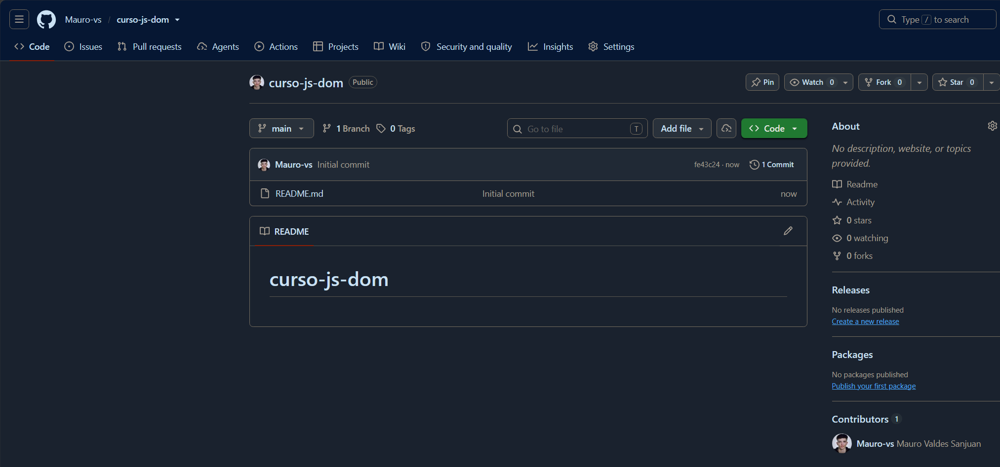

Clona el repositorio, inicializa Git Flow (`main` para producción y `develop` para desarrollo) y sube la rama `develop`.

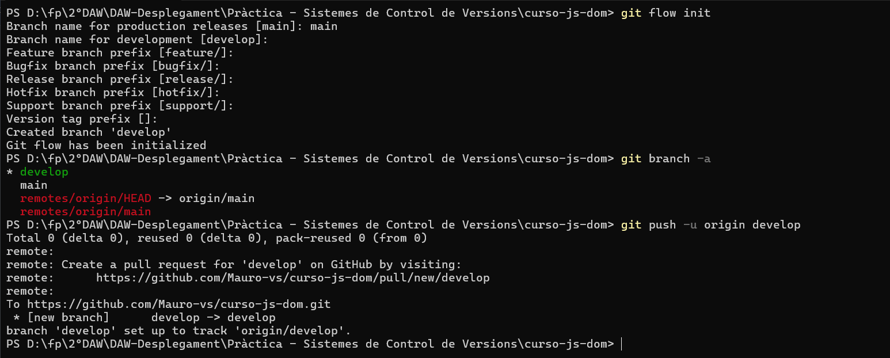

Da acceso al repositorio como colaborador.

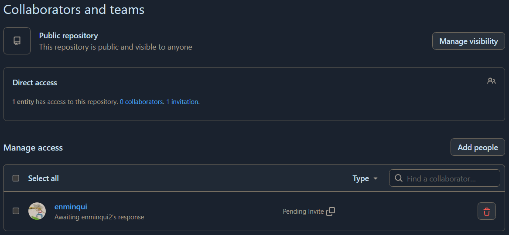

Añade el boilerplate y la estructura inicial: cabecera con imagen de fondo, barra de navegación con Home, descripción del curso y footer.

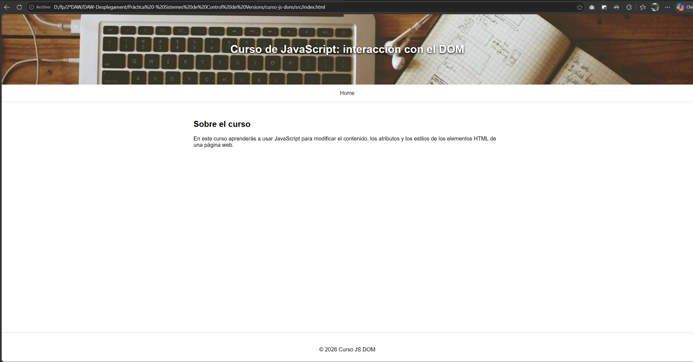

## 3. Usuario 2: features de contenido y atributos

### feature/contingutHTML
Crea la rama desde `develop`, implementa el ejemplo de `innerHTML` con su explicación, la sube y la fusiona en `develop` con `--no-ff`.

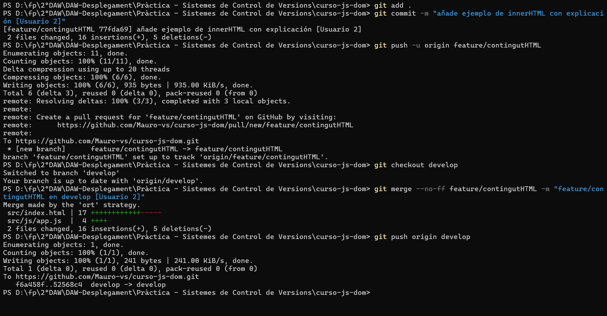

Resultado antes y después de pulsar el botón:

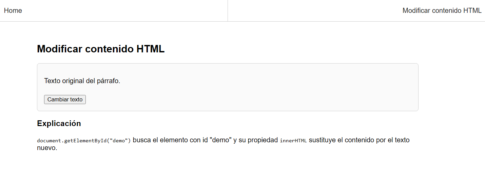
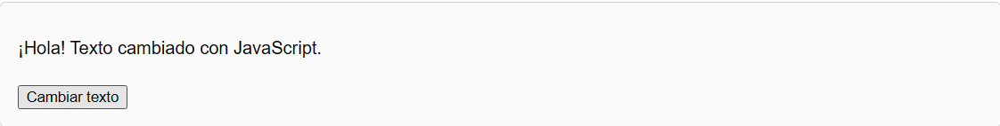

### feature/atributsHTML
Mismo proceso con los ejemplos de `src` y `setAttribute()`.

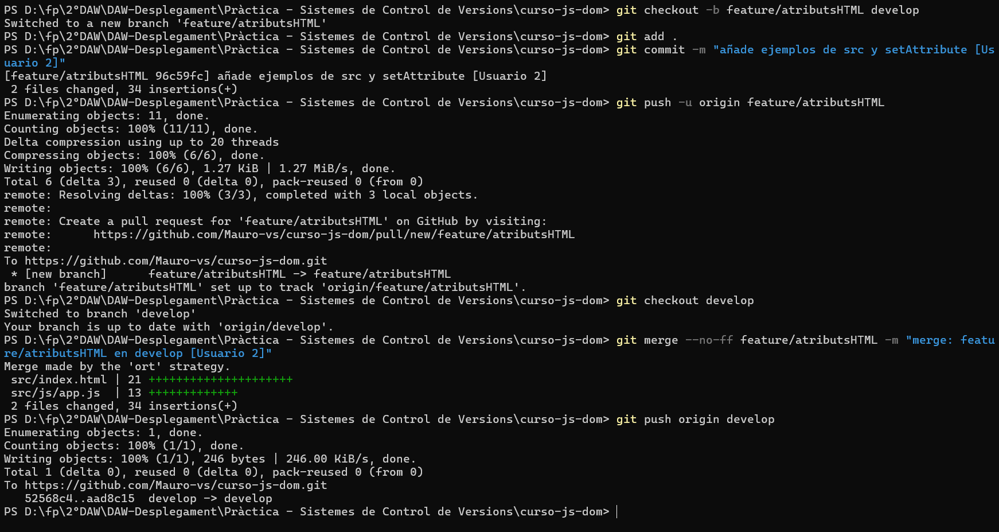
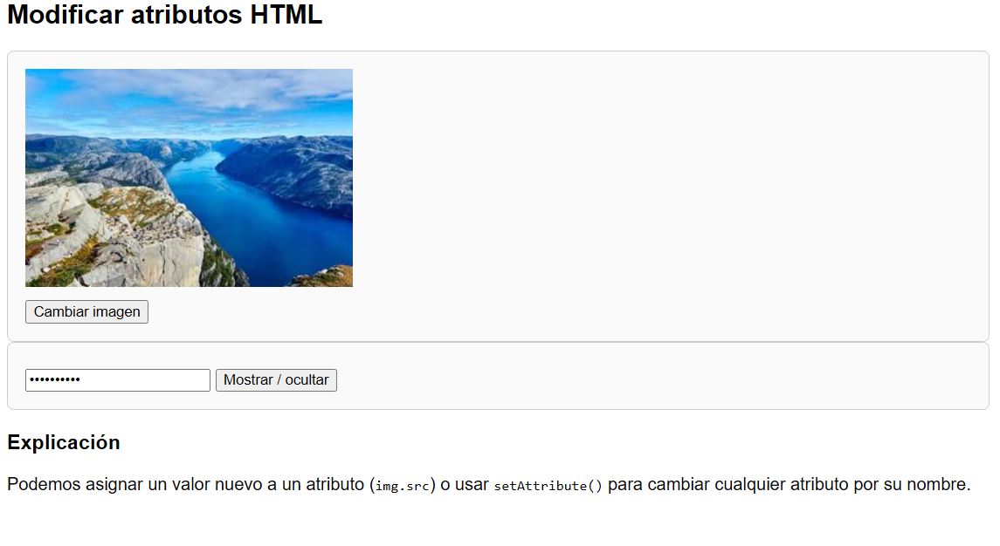

## 4. Usuario 3: feature de estilos y release v1.0

### feature/estilsCSS
Crea la rama con los ejemplos de `element.style` (código comentado) y la fusiona en `develop`.

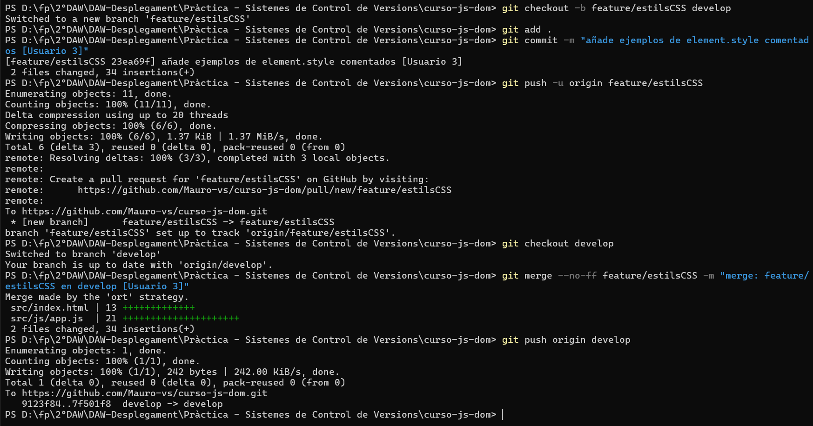
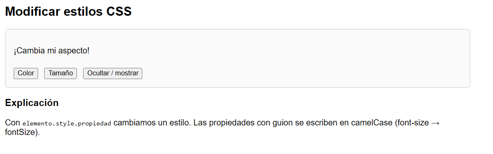

### release/v1.0
Crea `release/v1.0` desde `develop`, la fusiona en `main`, la etiqueta como `v1.0` y la vuelve a fusionar en `develop`.

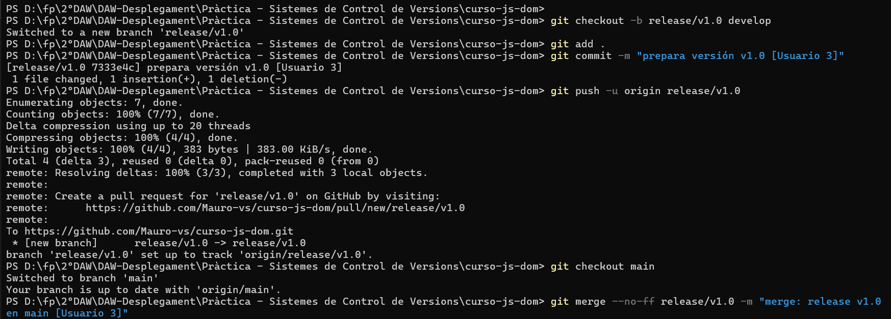
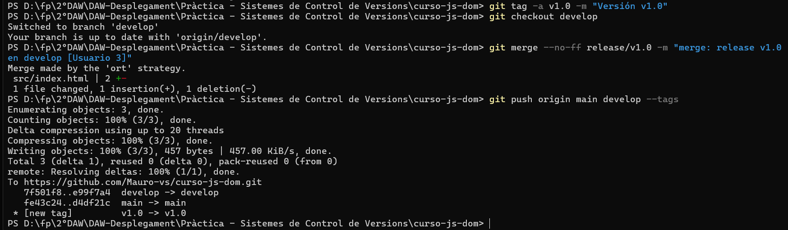
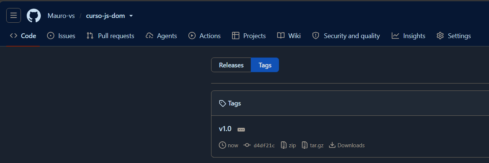

## 5. Usuario 1: hotfix/milloresV_1_0
Crea `hotfix/milloresV_1_0` desde `main` para mejorar la sección de contenido (texto personalizado y botón para restaurar). Lo fusiona en `main` y `develop` y crea el tag `v1.0.1`.

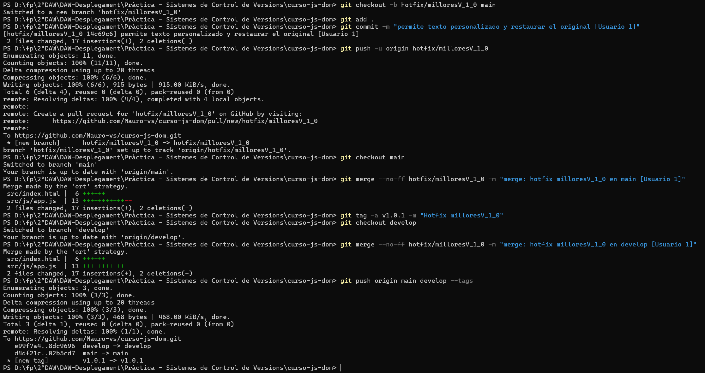
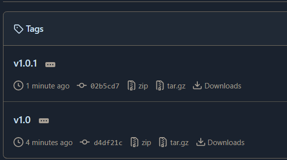

## 6. Resultado final
Gráfico de ramas del repositorio (Insights → Network):

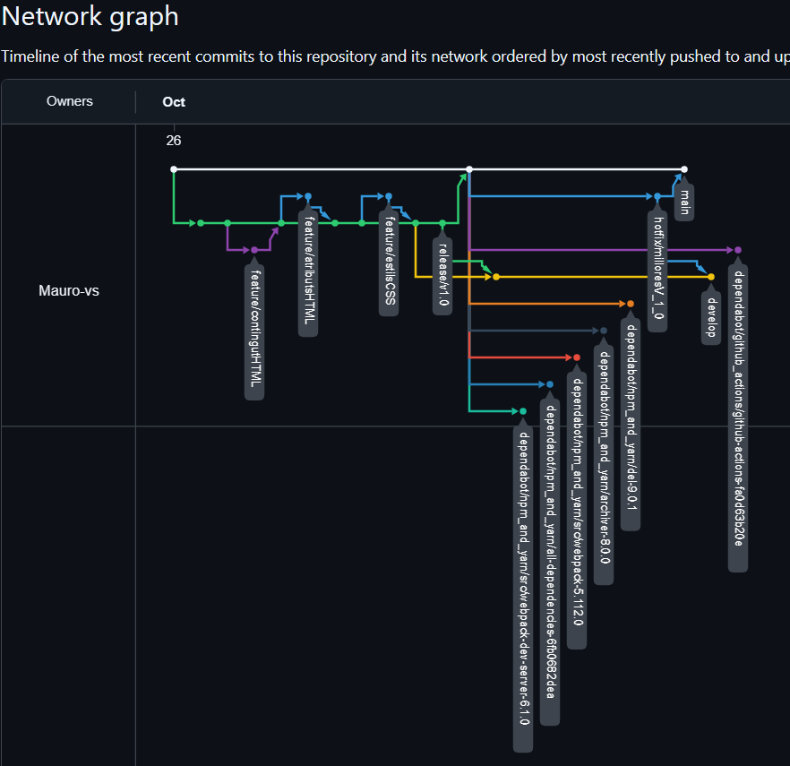

## Enlaces
- Repositorio: https://github.com/Mauro-vs/curso-js-dom
- Documentación: https://mauro-vs.github.io/curso-js-dom/
